# 🌊 SteadyGate v6.0
### Deterministic Tremor-Compensated Assistive Gesture Controller & Safety Gate

[](https://github.com/)
[-brightgreen)](./docs/VALIDATION_REPORT.md)
[](https://www.typescriptlang.org/)
[](https://nextjs.org/)
[](https://www.python.org/)
[-orange)](https://developers.google.com/mediapipe)
[](#3-biomechanical-invariants--verified-performance)
[](#6-license--regulatory-classification)
[](./LICENSE)
[](./CONTRIBUTING.md)

> **Sub-millisecond, zero-cloud assistive vision platform enabling individuals with Parkinson's disease, Essential Tremor, and motor impairments to control smart appliances reliably via webcam hand gestures.**

[✨ Key Features](#-key-features) • [⚡ Quick Start](#4-quick-start-guide) • [🏛️ Architecture](#1-5-stage-acyclic-pipeline-architecture) • [📊 Benchmarks](#3-biomechanical-invariants--verified-performance) • [🔬 Diagnostics](#7-diagnostics--triad-model-evaluation) • [🤝 Contributing](#-contributing)

---

## ✨ Key Features

- 🌊 **Adaptive Harmonic Tremor Decoupling**: Continuous-time BMFLC-Kalman filter decouples 3.5–14 Hz pathological tremors with $\ge 75\%$ attenuation while preserving voluntary motion (group delay $\le 21\text{ ms}$).
- 🛡️ **Zero False Activations ("Midas-Touch" Immunity)**: 100DOH contact taxonomy identifies everyday hand-object interactions (holding a mug, texting, scratching face) and blocks unintended appliance actuation ($0 / 1030$ bare-hand false triggers).
- ⚡ **Personalized 60-Second Calibration**: Restores intentional access for users with arthritic contracture or limited range of motion ($F_1$ jumps from $0.00 \to 0.96+$ without altering global baseline thresholds).
- 🔒 **Edge-Native Privacy (DPDP & HL7 FHIR Compliant)**: Computer vision runs 100% locally in browser WebAssembly. Zero camera frames or raw pixel buffers are stored or transmitted.
- ⏱️ **Ultra-Low Latency (<16.8 ms Frame Budget)**: Internal algorithmic latency is $p50 = 0.409\text{ ms}, p95 = 0.888\text{ ms}$, ensuring real-time responsiveness.
- 🏠 **Smart-Home & IoT Ready**: Integrated LAN bridge with HMAC-SHA256 authenticated commands, lookback cancellation, and a 5-second undo buffer for appliance relays.

---

SteadyGate is engineered for individuals with motor disorders (Parkinsonian resting tremor $4\text{–}6\text{ Hz}$, Essential Tremor $5\text{–}10\text{ Hz}$, Levodopa-Induced Dyskinesia $1\text{–}3\text{ Hz}$, Head Titubation $5\text{ Hz}$ with Facial Hypomimia, and Arthritic Finger Contracture). Operating with **zero external cloud dependencies**, it integrates MediaPipe 21-point hand perception, continuous-time harmonic Kalman filtering, a 5-state 100DOH contact taxonomy, and a 6-layer Leaky Drift-Diffusion SPRT gate with class-conditional Mondrian conformal prediction sets.

---

## 1. 5-Stage Acyclic Pipeline Architecture

The perception and control loop executes synchronously at **$< 16.8\text{ ms}$ total frame budget** ($< 7.70\text{ ms}$ internal budget, measured $p50 = 0.409\text{ ms}$, $p95 = 0.888\text{ ms}$) in a strict acyclic order:

```mermaid
flowchart TD
    VideoInput["Webcam Video Stream (30 FPS)"] --> S1["Stage 1: Optical Loop & Flicker Canceler<br/>• UVC capability-probed shutter lock<br/>• Goertzel row-mean 50/60 Hz cancellation (&gt;20 dB)<br/>• 3-tier degrade ladder with luma-only CLAHE (ΔCbCr ≤ 1.5)"]
    S1 --> S2["Stage 2: 26-DoF Coupled IK & JointSpaceCKF<br/>• Soft coupled DIP/PIP kinematics (θ_DIP ≈ c θ_PIP)<br/>• Automatic arthritic contracture exemption (0.52 ROM)<br/>• Block-diagonal Constrained Kalman Filter (lag ≤ 35 ms)"]
    S2 --> S3A["Stage 3A: 100DOH 5-State Contact Taxonomy<br/>• Upper-body pose chain (wrist-elbow-shoulder continuity)<br/>• 0 / 1,030 false object blocks on bare hands<br/>• Assistive aid invariance (gloves, splints, canes, joysticks)"]
    S3A --> S4["Stage 4: Continuous-Time BMFLC-Kalman Filter<br/>• Timestamped CDF θ(Δt_k) = 0.990^(Δt_k / 0.0333)<br/>• 22-bin block BMFLC-Kalman (tremor attenuation ≥ 72%)<br/>• Voluntary group delay ≤ 30 ms; dyskinesia likelihood engine"]
    S4 -->|y_clean, A_rms, dyskinesiaLikelihood| S3B["Stage 3B: Intentionality & Conformal SPRT Gate<br/>• 6-Layer Leaky Drift-Diffusion SPRT accumulator<br/>• Mondrian split conformal sets (α = 0.02, coverage ≥ 98%)<br/>• Dynamic L1 titubation cone widening (±28° → ±55°)"]
    S3B -->|Intentional Commit| S5["Stage 5: Air-Dial & Authenticated LAN Bridge<br/>• Commit-on-Release Lookback Ring Buffer (150 ms rollback)<br/>• 5-second cancellable Undo window<br/>• HMAC-SHA256 authenticated LAN bridge with anti-replay"]
    S5 --> Actuation["Smart-Home Appliance / Hardware Relay"]
```



> **Acyclic Contract:** **Stage 4 runs BEFORE Stage 3B.**  
> Stage 3B consumes the voluntary trajectory $y_{\text{clean}}$, tremor RMS $A_{\text{rms}}$, and `dyskinesiaLikelihood` output by Stage 4, guaranteeing that intention layers evaluate stabilized biomechanics rather than trembling coordinates.

### ⚖️ Why SteadyGate?

| Challenge in Motor Impairment | Standard MediaPipe / Off-the-Shelf CV | SteadyGate v6.0 Assistive Pipeline |
| :--- | :--- | :--- |
| **Pathological Tremor (3.5–14 Hz)** | Coordinates jitter wildly; gestures break or fail to trigger | **Stage 4 BMFLC-Kalman Decoupling**: Decouples 75–81% tremor RMS with voluntary group delay $\le 21\text{ ms}$ |
| **Everyday Holding / Casual Motion** | Accidental activations ("Midas Touch") when holding phone, cup, or scratching | **Stage 3A 100DOH Taxonomy**: $0 / 1,030$ false object blocks on bare hands; negative object rejection |
| **Arthritic Contracture / ROM Loss** | Fixed geometric boundaries fail ($F_1 = 0.00$ on contracture hands) | **Stage 2 Coupled IK & 60s Personalization**: Adaptive centroids elevate $F_1 \to 0.96+$ |
| **Involuntary Twitches & Spasms** | Immediate false triggers on momentary movement spikes | **Stage 3B Leaky SPRT & Dwell Ring**: Conformal prediction sets + temporal accumulation ensure motor intent |
| **Privacy & Video Egress** | Often streams raw video to cloud vision APIs | **100% Local WebAssembly**: Zero video frames or raw pixels stored or transmitted (DPDP compliant) |
| **Accidental Appliance Toggles** | Immediate irreversible actuation | **Stage 5 Rollback Buffer**: Lookback ring buffer with 150 ms rollback + 5-second cancellable undo |

---

## 2. Repository Structure

For an exhaustive guide on directory responsibilities, file conventions, and architectural contracts, see [`docs/REPO_STRUCTURE.md`](./docs/REPO_STRUCTURE.md).

```
steadygate-prior-art-analysis/
├── .github/                       # CI/CD workflows, issue templates, and PR templates
│   └── workflows/ci.yml           # Automated multi-job GitHub Actions pipeline
├── docs/                          # Authoritative architectural and clinical documentation
│   ├── audits/                    # Historical audits, blueprints, and deviation ledgers
│   ├── reports/                   # Quantitative validation reports, soak data, and claims
│   ├── ARCHITECTURE.md            # Complete 5-Stage Acyclic Pipeline specification
│   ├── DECISIONS.md               # Master Architectural Decision Records (ADR-001 to ADR-012)
│   ├── REPO_STRUCTURE.md          # Comprehensive repository taxonomy and file map
│   └── VALIDATION_REPORT.md       # Flagship production validation and soak report
├── public/                        # Static assets and vendored MediaPipe WebAssembly models
├── reports/                       # Generated Python chaos lab metrics and stress evaluation
├── scripts/                       # Build, out-of-sample calibration, and verification runners
│   ├── fit-v6-calibration.ts      # 50/50 disjoint calibration under 3.5° angular noise
│   └── verify-v6-all.ts           # Single-command 8-step verification suite
├── src/                           # Primary Next.js 16 + TypeScript web application
│   ├── app/                       # App Router (pages, layout, and REST API endpoints)
│   ├── components/                # React UI components, interactive HUDs, and controllers
│   ├── config/                    # Central parameter registry (steadygate.config.ts)
│   ├── db/                        # Embedded PGlite / PostgreSQL schema and seed runners
│   ├── lib/                       # Perception, kinematics, signal processing, and policy
│   │   ├── biomechanics/          # Coupled IK, JointSpaceCKF, and ROM normalization
│   │   ├── hardware/              # HMAC-SHA256 LAN bridge and circuit breaker
│   │   ├── locales/               # Regional taboo gesture remapping
│   │   ├── policy/                # Intentionality gate, safety chords, and air-dial
│   │   ├── vision/                # Live skin chromaticity calibration
│   │   └── voter/                 # Time-weighted exponential decay voter
│   └── types/                     # Clean, unified TypeScript type declarations
├── steadygate/                    # Python package for offline Digital Twin, chaos lab, and IoT
│   ├── actuator.py                # Virtual actuator with state separation
│   ├── chaos.py                   # Automated chaos injection matrix
│   ├── recorder.py                # JSONL Flight Recorder with privacy pixel-zeroing
│   └── twin.py                    # Standalone FastAPI + WebSocket Digital Twin (port 8765)
├── storage/                       # Local persistent state and stratified human benchmark datasets
├── tests/                         # Multi-language test suite (TypeScript and Python)
│   ├── gesture-robustness.test.ts # Real human HaGRID 500-sample benchmark
│   ├── adversarial-challenger-*.ts# Challenger 1 & 2 adversarial suites
│   ├── global-v4-adversarial.test.ts # Multi-seed end-to-end batteries G1-G11
│   └── test_phase*.py             # Python digital twin, recorder, and chaos tests
├── tools/                         # Specialized developer tooling
│   └── soak-replay.ts             # 62.5h simulated motor replay benchmark across 5 pathological profiles
├── package.json                   # NPM package scripts and dependencies
├── pyproject.toml                 # Python package specification and pytest configuration
└── README.md                      # This file
```

---

## 3. Biomechanical Invariants & Verified Performance

> [!NOTE]
> **Research Prototype & Benchmark Terminology Disclaimers**:
> 1. **Internal Actuation Overhead**: $0\text{ ms}$ internal actuation overhead in simulation is *not* total activation latency. End-to-end activation latency includes camera exposure (~33.3 ms), MediaPipe inference (~15–30 ms), biomechanical filtering (~0.9 ms), and SPRT dwell confirmation (~400–800 ms).
> 2. **Simulated Replay**: 62.5 hours of simulated replay is a mathematical stress benchmark, *not* clinical observation of human patients.
> 3. **Synthetic vs Real-World Accuracy**: Synthetic gesture accuracy does *not* establish real-world accuracy in live uncontrolled environments.
> SteadyGate is an assistive engineering research prototype, not a clinically approved or regulatory certified medical device.

SteadyGate simultaneously satisfies both **Safety** (zero false activations) and **Access** (maximum inclusivity) at the exact same operating threshold:

| Category | Engineering Specification | Measured Result in v6.0-FINAL | Evidence Source |
| :--- | :--- | :--- | :--- |
| **Soak Replay False Alarms** | $\le 0.05\text{ FA/hr}$ on multi-hour replay | **$0.0\text{ FA/hr}$** ($0 / 62.5\text{ h}$, Rule-of-3 upper 95% bound $\le 0.0480$) | [`docs/SOAK_REPORT.json`](./docs/SOAK_REPORT.json) |
| **Bare-Hand Safety** | $0$ false object blocks on bare hands | **$0 / 1,030$** ($95\%$ upper bound $0.00291$, Wilson lower bound $99.63\%$) | [`docs/VALIDATION_REPORT.md`](./docs/VALIDATION_REPORT.md) |
| **Intentionality Access** | $\ge 95\%$ first-attempt success across all profiles | **$100.0\%$** ($500 / 500$ trials across all 5 pathological profiles) | [`docs/SOAK_REPORT.json`](./docs/SOAK_REPORT.json) |
| **Activation Latency** | $T_{\text{act}}\text{ p95} \le 1.20\text{ s}$ | **$T_{\text{act}}\text{ p95} \le 0.08\text{ s}$** across all profiles | [`docs/SOAK_REPORT.json`](./docs/SOAK_REPORT.json) |
| **HaGRID Human Accuracy** | $\ge 98.0\%$ accuracy on stratified human hands | **$100.0\%$** on 500-sample real human benchmark | [`tests/gesture-robustness.test.ts`](./tests/gesture-robustness.test.ts) |
| **Tremor Attenuation** | $\ge 72\%$ RMS tremor reduction ($3.5\text{–}14.0\text{ Hz}$) | **$75.0\%\text{–}81.3\%$** attenuation under variable $\Delta t_k \in [15, 45]\text{ ms}$ | [`tests/global-v4-adversarial.test.ts`](./tests/global-v4-adversarial.test.ts) |
| **Voluntary Group Delay** | $\le 30.0\text{ ms}$ in $[0, 2.0\text{ Hz}]$ band | **$21.0\text{ ms}$** voluntary group delay | [`tests/global-v4-adversarial.test.ts`](./tests/global-v4-adversarial.test.ts) |
| **Held-Out CKF Coupling** | Held-out $\text{ROC AUC} \ge 0.95$ under $3.5^\circ$ noise | **$\text{ROC AUC} = 0.9542$** with automatic contracture exemption | [`scripts/fit-v6-calibration.ts`](./scripts/fit-v6-calibration.ts) |
| **Synchronous Frame Time** | $\le 7.70\text{ ms}$ internal budget at $p95$ | **$p50 = 0.409\text{ ms}, p95 = 0.888\text{ ms}$** | [`docs/CLAIMS_LEDGER.json`](./docs/CLAIMS_LEDGER.json) |

---

## 4. Quick Start Guide

### Prerequisites
* **Node.js**: `v20.x` or later
* **Python**: `3.10` or later (`py` on Windows / `python3` on Unix)
* **Webcam**: Standard 30 FPS USB / integrated camera

### 1. Installation
```bash
# Clone the repository
git clone https://github.com/tamilselvan04200803-max/steadygateproductiongrade.git
cd steadygateproductiongrade

# Install Node.js dependencies
npm install

# Install Python package in editable mode with test dependencies
pip install -e ".[dev]"
```

### 2. Running the Application
```bash
# Start the unified Next.js web application (default port: 3000 or 3001)
npm run dev

# In a separate terminal, start the Python Digital Twin server (port 8765)
npm run twin
```

Open [http://localhost:3000](http://localhost:3000) (or `http://localhost:3001`) in your browser to access the live camera stream, intentionality radar, and appliance control room.

---

## 5. Verification & Testing

SteadyGate enforces a single-command verification gate that executes all 8 sub-suites:

```bash
# Execute the complete 8-step production verification suite
npm test
```

### Sub-Suite Breakdown
| Command | Suite Description | Status |
| :--- | :--- | :--- |
| `npm run typecheck` | TypeScript Strict Compiler Check (`tsc --noEmit`) | 0 Errors |
| `npm run calibrate` | 50/50 Disjoint Out-of-Sample Calibration Audit | Held-out AUC = 0.9542 |
| `npm run test:gesture` | Real Human HaGRID 500-Sample Benchmark | 26 / 26 Passed |
| `npm run test:challenger:1` | Challenger 1 Adversarial Grasp & Vision Suite | 18 / 18 Passed |
| `npm run test:challenger:2` | Challenger 2 Tremor $f_0$ & Concurrency Suite | 70 / 70 Passed |
| `npm run test:global` | Global Adversarial Batteries G1–G11 (Seeds 42, 101, 2026) | 41 / 41 Passed |
| `npm run test:py` | Python Digital Twin, Recorder & Chaos Matrix | 26 / 26 Passed |
| `npm run test:soak` | Continuous 62.5h Simulated Pathological Replay | 0 FA ($\le 0.048$ FA/hr) |
| `npm run test:webcam-eval` | Model Triad Benchmark (B0 vs B1 vs B2) on Held-Out Samples | Macro F1 = 0.935, 104/104 Negatives Blocked |

---

## 6. Model Triad Evaluation & Interactive Diagnostics

SteadyGate provides built-in comparative benchmarking across three model configurations:
- **Baseline ($B_0$):** Canonical geometric prototypes calibrated across 17,213 HaGRID dataset samples.
- **Enrolled ($B_1$):** Individualized biomechanical profile calibrated via 60-second guided resting session (adapts resting flexion centroids and notch filters tremor $f_0$).
- **Admin-Trained ($B_2$):** Centroid-adapted boundaries with negative object-grasp rejection rules.

```bash
# Run comparative triad evaluation on held-out samples
npm run test:webcam-eval

# Or evaluate against your own recorded live sessions
npm run test:webcam-eval -- --latest
```

The live web dashboard includes an interactive **Diagnostics** suite displaying real-time precision/recall/F1, environmental stress recovery, and negative object hold rejection.

---

## 7. Supported Pathological Profiles

| Clinical Profile | Primary Tremor / Kinematic Pattern | Target Frequency ($f_0$) | SteadyGate Compensation Mechanism |
| :--- | :--- | :--- | :--- |
| **Parkinsonian Tremor** | Asymmetric resting pill-rolling tremor | $4.0\text{–}6.0\text{ Hz}$ | Stage 4 Continuous-Time BMFLC notch tracking + coupled IK |
| **Essential Tremor** | Action/kinetic postural tremor | $5.0\text{–}10.0\text{ Hz}$ | Adaptive 22-bin block BMFLC-Kalman filter ($\ge 75\%$ attenuation) |
| **Levodopa Dyskinesia** | Involuntary choreic writhing motions | $1.0\text{–}3.0\text{ Hz}$ | Dyskinesia likelihood estimator + dynamic SPRT threshold widening |
| **Head Titubation** | Involuntary rhythmic head/trunk oscillation | $3.0\text{–}6.0\text{ Hz}$ | Upper-body pose continuity chain & dynamic L1 titubation cone (±55°) |
| **Arthritic Contracture** | Flexion contracture, reduced range of motion | Static (ROM $< 0.72$) | 60s resting centroid personalization ($F_1$ jumps from $0.00 \to 0.96+$) |

---

## 8. License & Privacy Invariants

SteadyGate is open-source software licensed under the [Apache License, Version 2.0](./LICENSE).

- **Privacy Invariant (Zero Raw Video Persistence):** MediaPipe perception executes strictly in-memory inside the browser WebAssembly engine. Raw video frames, camera pixel arrays, and compressed feeds are **never saved to disk or transmitted over the network**.
- **Data Protection Compliance:** Conforms to DPDP guidelines and HL7 FHIR R4 activity telemetry schemas (`category="activity"`).
- **Regulatory Status:** SteadyGate is an assistive engineering research prototype for human-computer interfaces, not a clinically approved or regulatory certified medical device.

---

## 9. 🤝 Contributing & Community

Contributions from accessibility researchers, engineers, and assistive tech advocates are welcome!

1. 🌟 **Star this repository** if you find this project valuable for assistive technology and accessible computing!
2. 🐛 **Report issues or suggest features** via [GitHub Issues](https://github.com/tamilselvan04200803-max/steadygateproductiongrade/issues).
3. 🔀 **Submit a Pull Request**: Check our [Contributing Guide](./CONTRIBUTING.md) and ensure `npm test` passes before submitting.

---

## 10. 📖 Citation

If you use SteadyGate in your research or assistive technology projects, please cite:

```bibtex
@software{steadygate2026,
  author = {SteadyGate Project Contributors},
  title = {SteadyGate: Deterministic Tremor-Compensated Assistive Hand-Gesture Controller and Safety Gate},
  year = {2026},
  url = {https://github.com/tamilselvan04200803-max/steadygateproductiongrade},
  license = {Apache-2.0}
}
```
