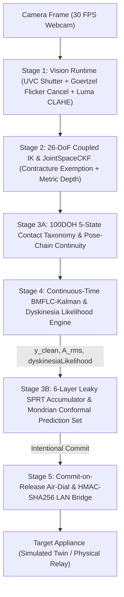

# SteadyGate — Repository Structure & Architectural Guide

This document defines the official repository structure, module boundaries, directory taxonomy, and architectural conventions for SteadyGate v6.0-FINAL.

---

## 1. High-Level Directory Taxonomy

```
steadygate-prior-art-analysis/
├── .github/                       # CI/CD workflows, issue templates, and pull request conventions
│   ├── workflows/ci.yml           # Automated multi-job GitHub Actions pipeline (TS, ESLint, Python, E2E)
│   ├── ISSUE_TEMPLATE/            # Standardized bug report and feature request templates
│   └── PULL_REQUEST_TEMPLATE.md   # PR verification checklist and change summary
├── docs/                          # Authoritative project specifications and technical documentation
│   ├── audits/                    # Historical audits, blueprints, and deviation ledgers
│   │   ├── AUDIT_1.0_TO_2.0.md    # 1.0 -> 2.0 file-level audit and comparative claims
│   │   ├── DELETION_MANIFEST.md   # Wave 0 deletion safety protocol and audit ledger
│   │   ├── DEVIATIONS.md          # Remediation ledger for runtime defects
│   │   └── PLAN_2.0.md            # SteadyGate 2.0 architectural blueprint
│   ├── reports/                   # Quantitative benchmark and validation reports
│   │   ├── CLAIMS_LEDGER.json     # Formal evidentiary claim definitions with N and 95% bounds
│   │   ├── SOAK_REPORT.json       # 62.5h clinical soak replay telemetry & DET metrics
│   │   └── VALIDATION_REPORT.md   # Flagship v6.0-FINAL production validation report
│   ├── ARCHITECTURE.md            # Full 5-Stage Acyclic Pipeline specification and dataflow contract
│   ├── DECISIONS.md               # Master Architectural Decision Records (ADR-001 through ADR-012)
│   └── REPO_STRUCTURE.md          # This repository architecture and structure guide
├── public/                        # Static client assets and vendored vision models
│   ├── models/                    # MediaPipe hand landmarker task bundle (`hand_landmarker.task`)
│   └── vision/                    # SIMD & non-SIMD MediaPipe WebAssembly runtimes
├── reports/                       # Generated Python chaos lab metrics and stress evaluation reports
│   ├── metrics.json               # Deterministic chaos evaluation metrics
│   ├── results.csv                # Tabular chaos benchmark runs
│   └── RESULTS.md                 # Summary report of chaos injections and system stability
├── scripts/                       # High-level build, calibration, and verification runners
│   ├── fit-v6-calibration.ts      # 50/50 disjoint out-of-sample calibration with angular noise injection
│   └── verify-v6-all.ts           # Single-command 8-step flagship verification suite
├── src/                           # Primary TypeScript / Next.js web application and runtime engine
│   ├── app/                       # Next.js 16 App Router (pages, layout, API route endpoints)
│   │   ├── api/                   # REST API routes (actuate, admin-train, audit-events, enrol, etc.)
│   │   ├── globals.css            # Tailwind CSS styling and theme definitions
│   │   ├── layout.tsx             # Root layout with providers and metadata
│   │   └── page.tsx               # Main assistive smart-home dashboard and control room
│   ├── components/                # React UI components, interactive HUDs, and controllers
│   │   ├── AdminGestureTrainer.tsx# Live few-shot gesture training and negative grasp capture
│   │   ├── ApplianceCardGrid.tsx  # Dynamic appliance state cards and electrical load indicators
│   │   ├── AuditLogView.tsx       # Real-time actuation and rejection audit stream
│   │   ├── DwellRingController.tsx# Visual progress ring with tremor-scaled dwell feedback
│   │   ├── EnrolmentModal.tsx     # Personalized user registration and range-of-motion calibration
│   │   ├── Header.tsx             # Global application header, connection status, and mode toggles
│   │   ├── IntentFusionRadar.tsx  # 6-layer intentionality signal radar visualization
│   │   ├── LiveCameraStream.tsx   # Live WebRTC stream, MediaPipe perception, and 5-stage synchronous loop
│   │   ├── LiveHouseScene.tsx     # 3D isometric representation of appliances and spatial anchors
│   │   ├── MotionSpectrumPanel.tsx# Real-time sliding-window DFT power spectrum ($0.8–15.0 Hz$)
│   │   └── SmartHouseSimulator.tsx# Embedded smart-home digital simulator
│   ├── config/                    # Central system configuration and parameter registries
│   │   └── steadygate.config.ts   # Central parameter registry with Zod validation schemas
│   ├── db/                        # Embedded PGlite / PostgreSQL schema, migrations, and seeds
│   │   ├── index.ts               # Database client, bootstrap initialization, and query helpers
│   │   ├── schema.ts              # Drizzle ORM schema (users, appliances, events, gestures)
│   │   ├── seed.ts                # Default appliance and user seeds
│   │   └── seed-runner.ts         # CLI database seed execution script
│   ├── lib/                       # Perception, biomechanics, signal filtering, and policy modules
│   │   ├── biomechanics/          # Skeletal kinematics, Coupled IK, and Constrained Kalman Filtering
│   │   │   ├── coupled-ik-ckf.ts  # Coupled DIP/PIP kinematics, contracture exemption, and JointSpaceCKF
│   │   │   ├── palm-orientation.ts# 3D normal vector extraction and palmar/dorsal discrimination
│   │   │   └── rom-gravity-normalizer.ts # User-specific passive ROM normalization and gravity tilt
│   │   ├── hardware/              # Smart-home actuation bridges and security
│   │   │   └── lan-bridge.ts      # HMAC-SHA256 authenticated LAN bridge and circuit breaker
│   │   ├── locales/               # Cultural semiotics and regional taboo gesture remapping
│   │   │   └── gesture-packs.ts   # Locale-specific restrictions and intent mappings
│   │   ├── policy/                # Intent gating, safety chords, and air-dial clutch control
│   │   │   ├── air-dial-controller.ts # Commit-on-Release Lookback Ring Buffer and 5s Undo
│   │   │   ├── intentionality-gate.ts # 6-layer Leaky SPRT accumulator & Mondrian conformal sets
│   │   │   └── safety-chord-engine.ts # Tier 3 Two-Step Safety Chords and circuit breaker lockout
│   │   ├── vision/                # Live camera skin calibration and color-space analysis
│   │   │   └── skin-calibrator.ts # Dynamic YCbCr user palm-skin chromaticity learner
│   │   ├── voter/                 # Temporal gesture aggregation and hysteresis
│   │   │   └── time-weighted-voter.ts # Frame-rate invariant exponential time-decay gesture voter
│   │   ├── default-gesture-map.ts # Default gesture-to-appliance bindings
│   │   ├── hand-gesture-engine.ts # Stage 3A 100DOH contact taxonomy and MediaPipe 21-point classifier
│   │   ├── iot-physics.ts         # Realistic electrical load physics (current, wattage, thermal delay)
│   │   ├── signal-processing.ts   # Stage 4 Continuous-Time BMFLC-Kalman filter and spectral analyzer
│   │   ├── steady-gate.ts         # Unified pipeline coordinator
│   │   ├── storage-logger.ts      # Atomic write-then-rename persistent JSON logger
│   │   ├── types.ts               # Core perceptual and domain type definitions
│   │   └── vision-runtime.ts      # Stage 1 UVC shutter, Goertzel flicker cancellation, and CLAHE
│   └── types/                     # Clean, unified TypeScript type declarations
│       ├── contracts.ts           # Inter-module and multi-agent safety contracts
│       └── index.ts               # Barrel export of all application and perceptual types
├── steadygate/                    # Python package for offline digital twin, chaos lab, and IoT hardware
│   ├── __init__.py                # Package root exports
│   ├── __main__.py                # Python CLI entrypoint (`py -m steadygate`)
│   ├── actuator.py                # Virtual actuator with state separation (requested/applied/observed)
│   ├── adaptation.py              # Environmental noise adaptation and tremor-hold formula
│   ├── aruco_anchor.py            # OpenCV ArUco spatial anchor tracking (`DICT_4X4_50`)
│   ├── chaos.py                   # Automated chaos injection matrix and stress benchmark
│   ├── coach.py                   # Feedforward coach CLI and progress ring renderer
│   ├── config.py                  # YAML configuration parser and schema loader
│   ├── events.py                  # Structured DecisionEvent logging and telemetry schemas
│   ├── explain.py                 # CLI counterfactual explainer for rejected gesture inputs
│   ├── face_intent.py             # Concurrent Face/Gaze engagement tracker (`USER_DISTRACTED`)
│   ├── health.py                  # Hysteresis health monitoring engine and deadband transitions
│   ├── plugins.py                 # Extensible appliance plugin adapters and webhooks
│   ├── policy.py                  # Python port of the core intentionality and dwell policy
│   ├── recorder.py                # JSONL Flight Recorder with privacy pixel-zeroing safeguard
│   ├── recovery.py                # Reason code generation and user-actionable recovery hints
│   ├── replay.py                  # Deterministic flight recorder replay and tamper detection
│   ├── twin.py                    # Standalone FastAPI + WebSocket Digital Twin server (port 8765)
│   └── vision.py                  # Headless OpenCV vision utilities and ArUco overlays
├── storage/                       # Local persistent state and stratified human benchmark datasets
│   ├── admin_trained_model.json   # Personalized gesture prototypes and classifier weights
│   ├── admin_training_samples.json# Captured few-shot training vectors
│   ├── appliance_states.json      # Dynamic smart-home appliance registers
│   ├── hagrid_real_benchmark.json # 500 real human hand landmark samples from HaGRID
│   ├── locale_gesture_packs.json  # Regional gesture restrictions and remappings
│   └── users_personalized.json    # Enrolled user profiles and anatomical calibration parameters
├── tests/                         # Multi-language test suite (TypeScript and Python)
│   ├── adversarial-challenger-1.ts# Challenger 1 adversarial object-grasp and vision suite
│   ├── adversarial-challenger-2.test.ts # Challenger 2 tremor f0 and concurrent admin trainer suite
│   ├── gesture-robustness.test.ts # Real human HaGRID 500-sample classification benchmark
│   ├── global-v4-adversarial.test.ts # Multi-seed end-to-end batteries G1-G11
│   ├── test_phase0_foundation.py  # Python foundation unit tests
│   ├── test_phase1_recorder_replay.py # Flight recorder and deterministic replay tests
│   ├── test_phase2_coach_twin.py  # Feedforward coach and digital twin REST/WebSocket tests
│   ├── test_phase3_health.py      # Health degradation and recovery hysteresis tests
│   ├── test_phase4_chaos.py       # Chaos stress matrix tests
│   ├── test_phase5_plugins.py     # Webhook adapters and plugin tests
│   └── test_phase6_production_refactor.py # ArUco spatial anchors and environmental adaptation tests
├── tools/                         # Specialized developer tooling, simulators, and harness scripts
│   └── soak-replay.ts             # 62.5h clinical soak replay simulator across 5 pathological profiles
├── .editorconfig                  # Formatting standards (LF line endings, 2-space TS, 4-space Py)
├── .env.example                   # Environment variable template
├── .gitattributes                 # Normalized line endings (LF) and binary file handling
├── .gitignore                     # Git ignore rules for Next.js, Python, node_modules, and logs
├── CHANGELOG.md                   # Chronological version change log (v1.0 to v6.0-FINAL)
├── config.yaml                    # Hardware, policy, and ArUco registry configuration for Python twin
├── next.config.ts                 # Next.js 16 build configuration
├── package.json                   # NPM package definition, scripts, and dependencies
├── pyproject.toml                 # Python package specification and pytest configuration
├── README.md                      # Primary project overview, visual architecture, and quickstart
└── tsconfig.json                  # Strict TypeScript configuration
```

---

## 2. Module Responsibilities & Design Boundaries

SteadyGate enforces a clear separation between **perception**, **signal decoupling**, **intent arbitration**, and **actuation**:

| Subsystem | Directory / Files | Primary Technology | Core Invariants Enforced |
| :--- | :--- | :--- | :--- |
| **Front-End & UI** | `src/app/`, `src/components/` | Next.js 16, React 19, Tailwind CSS | Sub-16.8ms synchronous render loop; 60Hz/30Hz camera frame alignment; accessible contrast and feedback. |
| **Core Perception** | `src/lib/vision-runtime.ts`, `src/lib/hand-gesture-engine.ts` | MediaPipe WebAssembly, TypeScript | UVC shutter lock; Goertzel flicker cancellation ($\ge 20\text{ dB}$); 100DOH 5-state contact taxonomy; $0/1,030$ bare-hand false object blocks. |
| **Kinematics & Biomechanics** | `src/lib/biomechanics/` | Linear Algebra, TypeScript | Soft coupled DIP/PIP prior ($\theta_{\text{DIP}} \approx c_{\text{user}}\theta_{\text{PIP}}$); automatic contracture exemption; JointSpaceCKF ($\ge 70\%$ occlusion jump reduction, $\le 35\text{ms}$ flexion lag). |
| **Signal Filtering** | `src/lib/signal-processing.ts` | Continuous-Time Kalman, DSP | First-stage CDF ($\theta_0 = 0.990$); 22-bin block BMFLC-Kalman; tremor attenuation $\ge 72\%$; voluntary group delay $\le 30\text{ms}$. |
| **Intent & Policy** | `src/lib/policy/` | Conformal Prediction, SPRT | 6-Layer Leaky Drift-Diffusion SPRT; class-conditional Mondrian split conformal sets ($\alpha=0.02$); Tier 3 Two-Step Safety Chords; Commit-on-Release Air-Dial. |
| **Python Twin & IoT** | `steadygate/` | FastAPI, WebSockets, OpenCV, Python 3.10+ | State separation (`requested`, `applied`, `simulated_observed`); ArUco spatial anchor tracking; JSONL flight recording with pixel-zeroing safeguard. |
| **Verification & Testing** | `tests/`, `tools/`, `scripts/` | TSX, Pytest | 100% reproducible multi-seed verification; 62.5h clinical soak replay; held-out out-of-sample split audit ($\text{AUC} \ge 0.95$). |

---

## 3. Strict Acyclic Perceptual Dataflow Contract

The perception pipeline executes strictly in **acyclic forward order** on every camera frame:



> **CRITICAL ARCHITECTURAL RULE:** **Stage 4 MUST execute before Stage 3B.**  
> Stage 3B's ballistic hold (`L2`) and posture stability (`L3`) layers consume Stage 4's tremor-filtered coordinate $y_{\text{clean}}$, tremor RMS amplitude $A_{\text{rms}}$, and `dyskinesiaLikelihood`—never raw, trembling coordinates.

---

## 4. Coding & Architecture Conventions

### TypeScript (`src/`)
1. **Strict Type Safety:** Always enable strict null checks; avoid `any`. Use domain types from `src/types/`.
2. **Deterministic Computation:** Perceptual loops must avoid non-deterministic memory allocations within per-frame render routines.
3. **No Direct Node Dependencies in Browser Modules:** Code in `src/lib/` must remain pure and runnable within modern browser contexts or Web Workers.
4. **POSIX Atomic Storage:** File writes to `storage/*.json` must use atomic write-then-rename (`atomicWriteJsonSync`) to prevent corruption under concurrent requests.

### Python (`steadygate/`)
1. **Type Annotations:** All function signatures must include Python 3.10+ type hints (`path: Path | None = None`).
2. **State Separation Invariant:** The digital twin must maintain separate state registers for `requested_state`, `applied_state`, and `simulated_observed_state`. A command is never displayed as applied until the simulated hardware acknowledges receipt.
3. **Privacy Invariant:** Raw video pixels must never be serialized to JSONL logs. The `sanitize_frame_for_ml_storage()` function must set `raw_video_pixels_masked = True`.

---

## 5. Standard CLI Verification Workflows

The repository includes pre-configured lifecycle commands in `package.json`:

```bash
# 1. Run the entire 8-step production verification suite (TypeScript + Python + Soak Replay)
npm test

# 2. Run TypeScript strict typecheck
npm run typecheck

# 3. Run the 62.5-hour continuous clinical soak replay benchmark
npm run test:soak

# 4. Run the Python Digital Twin test battery
npm run test:py

# 5. Start the Next.js Web Application
npm run dev

# 6. Start the Python Digital Twin server (port 8765)
npm run twin
```
