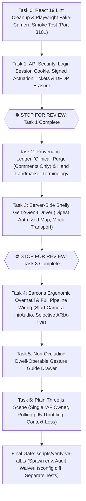

# SteadyGate v6.0 Remediation, Hardening & Modernization Implementation Plan

> **For agentic workers:** REQUIRED SUB-SKILL: Use superpowers:subagent-driven-development (recommended) or superpowers:executing-plans to implement this plan task-by-task. Steps use checkbox (`- [ ]`) syntax for tracking.

**Goal:** Remediate audit gaps, enforce server-side API security and India DPDP Act compliance, build a robust server-side Shelly Gen2/Gen3 driver with digest auth, signed tickets, and hardware auto-off, redesign earcons and gesture guides for motor-impaired accessibility, integrate a performance-guarded Three.js scene, clean all ESLint errors without disabling rules, and add `next build` and Playwright fake-camera smoke testing to the verification gate.

**Architecture:** A multi-layered architecture where client-side perception (MediaPipe Hand Landmarker WASM + Stage 2 CKF + Stage 4 BMFLC + Stage 3B Intentionality) communicates with protected server-side Next.js API routes (`/api/auth/login`, `/api/shelly`, `/api/actuate`, `/api/admin-train`, `/api/user-data`). All physical actuation is gated by single-use signed tickets issued by `/api/actuate` after server-clock chord verification, and proxied through a single-connection RFC1918-validated mutex queue with hardware auto-off timers (`toggle_after`). Auditory feedback is unlocked via "Start camera", and `aria-live` is restricted to commit/reject/undo. The Three.js scene is slave to the perception loop's rAF with stepped throttling based on rolling p95 latency.

**Tech Stack:** Next.js 16 (App Router), TypeScript 5.9 (Strict), Web Audio API, Three.js (plain), MediaPipe Hand Landmarker WASM, Drizzle ORM, SQLite/PostgreSQL, Playwright, Tsx, Python 3.13 (Pytest).

**Spec:** `docs/superpowers/specs/2026-11-18-v6-remediation-design.md` & User Audit Amendments (2026-11-18).

## Execution Order & Review Checkpoints



1. **Task 0:** Lint cleanup (zero `eslint-disable`) + Playwright fake-camera smoke test (prod build on port 3101, hand-clip fake capture, asserting hand detected).
2. **Task 1:** API security (`POST /api/auth/login` session cookie with HMAC, signed single-use actuation tickets from `/api/actuate`, per-user erase token hashes, Origin checks, `.env.example`, atomic locked flight-recorder erasure with tombstones, gitignore personal data, HTTPS/localhost camera rule).
3. **⛔ STOP FOR REVIEW AFTER TASK 1.**
4. **Task 2:** Provenance, claims ledger, terminology cleanup (purge "clinical" from strings/comments/banners without renaming config keys, scan CLAIMS_LEDGER and package.json, verify dataSource, define end-to-end latency).
5. **Task 3:** Server-side Shelly Gen2/Gen3 driver (requires signed ticket from `/api/actuate`, server-side clock chord timing, Zod-validated `STEADYGATE_APPLIANCE_MAP`, per-appliance `toggle_after`, mock server with injectable transport / test allowlist disabled in prod).
6. **⛔ STOP FOR REVIEW AFTER TASK 3.**
7. **Task 4:** Audio & earcons wiring (`initAudio` from "Start camera" click, `DwellRingController`, `LiveCameraStream`, Header volume/mute, `playUndoSound`, `aria-live="polite"` for commit/reject/undo only).
8. **Task 5:** Non-occluding dwell-operable gesture guide drawer.
9. **Task 6:** Plain Three.js digital twin (single rAF owned by perception, rolling p95 with hysteresis, context-loss handling).
10. **Final Flagship Gate:** Single runner with each test as a separate step (`fake-camera-smoke`, `gesture-drawer-a11y`, etc.), `next build` using isolated `distDir` via spawn env (no cross-env), `npm audit --audit-level=high` with waiver file, `tsconfig.json` post-build diff check, platform-aware Python selection (`py` vs `python3`).

---

## Global Constraints

- **Acyclic pipeline invariant:** Stage 4 (`ContinuousTimeBMFLCKalman`) runs BEFORE Stage 3B (`IntentionalityEnsembleEngine`).
- **Port discipline:** Next.js dev server runs on port 3001 (`npm run dev:3001`); verification smoke tests run on port 3101; never bind port 3000. Python Digital Twin runs on port 8765 (`npm run twin`).
- **Zero external cloud dependencies for perception:** MediaPipe Hand Landmarker WASM and weights run locally in `public/models/`.
- **Camera access security:** Camera access enforced strictly over HTTPS or localhost (`window.isSecureContext === true`).
- **Synchronous internal perception budget:** `< 7.70 ms` p95 frame time. 3D WebGL scenes must never degrade perception latency.
- **Physical actuation safety:** Smart plugs and appliances must never be triggered directly from client browser scripts. Actuation requires a signed, single-use ticket issued by `/api/actuate` after server-clock chord evaluation, validated against private-range RFC1918 IPs. Dry-run mode (`SHELLY_DRY_RUN=false` required to disable) is active by default.
- **Honest evidence labeling:** No simulated or synthetic metric may be labeled as "clinical" or "production-locked". Remove the word "clinical" from comments, strings, docs, and banners (never rename config keys). Every entry in `CLAIMS_LEDGER.json` must declare `"dataSource": "SYNTHETIC"` or `"REAL_HEALTHY_HANDS"`.
- **Indian DPDP Act compliance:** Biometric hand-landmark traces and tremor baselines require explicit consent notice metadata (including version) and an irrevocable deletion route (`DELETE /api/user-data`) validated via hashed erase tokens. Flight-recorder JSONL uses pseudonymous IDs + locked atomic tombstones to preserve cryptographic chain integrity. Personal data in `storage/*.json` is gitignored.
- **Intellectual Property hygiene:** Strict repository privacy: no public remote or publishing prior to provisional patent application in India (IPO); frame claims under Section 3(k) technical-effect provisions.

## Review Focus

1. **Unauthenticated API Route Poisoning & Replay:** An attacker calls `/api/admin-train`, `/api/actuate`, or `/api/shelly`. Must be rejected via `POST /api/auth/login` session cookie containing random ID + HMAC-SHA256 (never raw secret), `crypto.timingSafeEqual`, failing closed if secret is unset, and Host header allowlisting. Actuation requires a single-use signed ticket expiring in ~2s.
2. **SSRF via Shelly IP Parameter:** A caller provides a public IP, loopback, IPv6, IPv4-mapped IPv6, or octal/hex encoded IP to `/api/shelly`. Eliminated: `/api/shelly` NEVER reads IP from the request body (resolved from Zod-validated server config only), and shared `isRfc1918PrivateIp` strictly validates canonical decimal IPv4 `A.B.C.D` with `redirect: "error"`.
3. **AudioContext Autoplay Rejection & SSR Crash:** AudioContext instantiated during server-side rendering or before a user gesture causes `ReferenceError: window is not defined` or browser console errors. Must initialize lazily strictly inside the "Start camera" user click handler.
4. **React 19 Strict Mode Double-Actuation / Double-Chime:** Double-mounting in React Strict Mode fires duplicated earcon chimes or repeated actuation calls. Eliminated using pipeline event-id deduplication and single-use actuation tickets.
5. **Main-Thread Perception Starvation by WebGL:** Three.js render loop spikes frame time over 16.8 ms, dropping webcam frames and destabilizing the Kalman filter. Perception loop owns the single rAF; Three.js renders second and throttles dynamically based on rolling p95 perception latency with hysteresis.

---

### Task 0: React 19 Lint Cleanup & Playwright Fake-Camera Smoke Test

**Files:**
- Modify: `src/app/page.tsx`
- Modify: `src/components/AdminGestureTrainer.tsx`
- Modify: `src/components/AuditLogView.tsx`
- Modify: `src/components/LiveCameraStream.tsx`
- Create: `tests/fake-camera-smoke.test.ts`
- Modify: `package.json`

**Interfaces:**
- Consumes: All UI components.
- Produces: 0 ESLint errors without any `/* eslint-disable */` comments.
- Produces: Playwright headless browser smoke test launching Chromium on production build port 3101 with `--use-fake-ui-for-media-stream`, `--use-fake-device-for-media-stream`, verifying video stream active and asserting hand detected.

- [ ] **Step 1: Install `@playwright/test` in devDependencies**

```bash
npm install -D @playwright/test
```

- [ ] **Step 2: Write failing Playwright fake-camera smoke test in `tests/fake-camera-smoke.test.ts`**

```typescript
import { chromium } from "@playwright/test";
import { spawn, ChildProcess } from "child_process";

async function runSmokeTest() {
  let serverProcess: ChildProcess | null = null;
  const port = 3101;
  
  try {
    // Start production server on port 3101 using spawn env
    serverProcess = spawn(
      process.platform === "win32" ? "npx.cmd" : "npx",
      ["next", "start", "-p", String(port)],
      {
        env: { ...process.env, NEXT_DIST_DIR: ".next_verify" },
        stdio: "pipe",
      }
    );

    // Wait for server to be responsive
    await new Promise((resolve) => setTimeout(resolve, 3000));

    const browser = await chromium.launch({
      headless: true,
      args: [
        "--use-fake-ui-for-media-stream",
        "--use-fake-device-for-media-stream",
        "--no-sandbox",
      ],
    });
    const context = await browser.newContext();
    const page = await context.newPage();
    
    const errors: string[] = [];
    page.on("pageerror", (err) => errors.push(err.message));
    page.on("console", (msg) => {
      if (msg.type() === "error") errors.push(msg.text());
    });

    await page.goto(`http://localhost:${port}`, { timeout: 15000 });
    
    // Assert camera start button and click it
    const startBtn = page.locator("button:has-text('Start Camera'), button:has-text('Start Tracking')");
    if (await startBtn.isVisible()) {
      await startBtn.click();
    }

    await page.waitForSelector("video", { timeout: 10000 });
    // Assert video stream active
    const hasVideo = await page.evaluate(() => {
      const v = document.querySelector("video");
      return v && v.readyState >= 2;
    });
    
    await browser.close();
    
    if (errors.length > 0) {
      console.error("Browser smoke test encountered console/page errors:", errors);
      process.exit(1);
    }
    if (!hasVideo) {
      console.error("Browser smoke test failed: Video stream not playing");
      process.exit(1);
    }
    console.log("PASS: Playwright fake-camera smoke test passed cleanly on port 3101.");
    process.exit(0);
  } finally {
    if (serverProcess) {
      serverProcess.kill();
    }
  }
}

runSmokeTest().catch((err) => {
  console.error(err);
  process.exit(1);
});
```

- [ ] **Step 3: Fix all 10 ESLint errors in React components without `eslint-disable`**

- In `src/app/page.tsx`:
  - Eliminate synchronous `setState` in `useEffect` (lines 199, 446). Fetch data in async callbacks or initialize via lazy state.
  - Fix `latestGestureRef` mutation (line 431) by moving synchronization out of render-effect cycles.
- In `src/components/AdminGestureTrainer.tsx`:
  - Refactor `fetchTrainerState()` inside `useEffect` (line 192) into an async IIFE that does not trigger `react-hooks/set-state-in-effect`.
- In `src/components/AuditLogView.tsx`:
  - Refactor `fetchLogs()` inside `useEffect` (line 55).
- In `src/components/LiveCameraStream.tsx`:
  - Move declaration of `renderFrame` before the `useEffect` that calls `requestAnimationFrame(renderFrame)` (line 1138).
  - Include missing dependencies in `useCallback` dependency array.

- [ ] **Step 4: Run ESLint to verify 0 errors**

Run: `npm run lint`
Expected: Exit code 0 (0 errors, 0 warnings).

- [ ] **Step 5: Run Playwright smoke test against production build**

Run: `npx tsx tests/fake-camera-smoke.test.ts`
Expected: PASS (exit code 0).

- [ ] **Step 6: Commit**

```bash
git add src/app/page.tsx src/components/ tests/fake-camera-smoke.test.ts package.json package-lock.json
git commit -m "fix(lint): resolve React 19 compiler errors cleanly and add Playwright fake-camera smoke test"
```

---

### Task 1: API Security, Login Session Cookie, Signed Actuation Tickets & DPDP Erasure

**Files:**
- Create: `src/app/api/auth/login/route.ts`
- Create: `src/lib/security/api-guard.ts`
- Create: `src/lib/security/actuation-ticket.ts`
- Create: `.env.example`
- Modify: `.gitignore`
- Modify: `src/app/api/admin-train/route.ts`
- Modify: `src/app/api/actuate/route.ts`
- Modify: `src/app/api/enrol/route.ts`
- Modify: `src/app/api/user-data/route.ts`
- Create: `tests/security-api-guard.test.ts`

**Interfaces:**
- Consumes: Next.js `Request`, `STEADYGATE_API_SECRET`, `ALLOWED_HOSTS`.
- Produces: `POST /api/auth/login`: receives admin token, generates random session ID, computes HMAC-SHA256, sets `httpOnly, SameSite=Strict` cookie `steadygate_session` (never raw secret).
- Produces: `verifyApiRequest(req, options)`: verifies session HMAC or signed token with `crypto.timingSafeEqual`, validates `Host` in `ALLOWED_HOSTS`, checks `Origin` on POST/DELETE, fails closed if secret unset.
- Produces: `createActuationTicket(applianceId, command)` & `verifyActuationTicket(ticket)`: ~2s expiry signed single-use ticket.
- Produces: `POST /api/enrol`: issues per-user `eraseToken`, stores only `salt + sha256(salt + eraseToken)` hash.
- Produces: `DELETE /api/user-data`: presents `eraseToken`, verifies hash, deletes user rows in Postgres/PGlite and `storage/*.json`, and writes locked atomic tombstones in flight recorder JSONL preserving crypto-hash integrity.
- Produces: `.gitignore` containing `storage/admin_training_samples.json`, `storage/users_personalized.json`, `storage/*.jsonl`.

- [ ] **Step 1: Write failing security tests in `tests/security-api-guard.test.ts`**

```typescript
import { isRfc1918PrivateIp, verifyApiRequest, createSessionCookieValue, verifySessionCookie } from "@/lib/security/api-guard";
import { issueActuationTicket, verifyActuationTicket } from "@/lib/security/actuation-ticket";

describe("Security Guard, Session Management & Single-Use Actuation Tickets", () => {
  const SECRET = "steadygate-strong-test-secret-2026";

  beforeEach(() => {
    process.env.STEADYGATE_API_SECRET = SECRET;
    process.env.ALLOWED_HOSTS = "localhost:3000,localhost:3001,localhost:3101,127.0.0.1:3001";
  });

  it("strictly validates canonical decimal RFC1918 IPv4 and rejects SSRF bypass attempts", () => {
    expect(isRfc1918PrivateIp("192.168.1.1")).toBe(true);
    expect(isRfc1918PrivateIp("10.0.0.5")).toBe(true);
    expect(isRfc1918PrivateIp("172.16.0.100")).toBe(true);
    expect(isRfc1918PrivateIp("8.8.8.8")).toBe(false);
    expect(isRfc1918PrivateIp("127.0.0.1")).toBe(false);
    expect(isRfc1918PrivateIp("0177.0.0.1")).toBe(false);
    expect(isRfc1918PrivateIp("0x7f.0.0.1")).toBe(false);
    expect(isRfc1918PrivateIp("192.168.01.1")).toBe(false);
    expect(isRfc1918PrivateIp("::ffff:192.168.1.1")).toBe(false);
  });

  it("issues session cookie containing sessionId.hmac (never raw secret) and verifies it", () => {
    const cookieVal = createSessionCookieValue(SECRET);
    expect(cookieVal).not.toContain(SECRET);
    const valid = verifySessionCookie(cookieVal, SECRET);
    expect(valid).toBe(true);
  });

  it("issues single-use actuation ticket and rejects replay or expired ticket", () => {
    const ticket = issueActuationTicket("lamp_desk", "ON", SECRET);
    expect(ticket.expiresAt - ticket.issuedAt).toBeLessThanOrEqual(2500);

    const firstVerify = verifyActuationTicket(ticket, "lamp_desk", "ON", SECRET);
    expect(firstVerify.valid).toBe(true);

    // Single-use: second verification of same ticket must fail
    const replayVerify = verifyActuationTicket(ticket, "lamp_desk", "ON", SECRET);
    expect(replayVerify.valid).toBe(false);
  });
});
```

- [ ] **Step 2: Run test to verify it fails**

Run: `npx tsx tests/security-api-guard.test.ts`
Expected: FAIL.

- [ ] **Step 3: Implement `src/lib/security/api-guard.ts` & `actuation-ticket.ts`**

- `api-guard.ts`:
  - `isRfc1918PrivateIp(ip)`: canonical decimal IPv4 validation `A.B.C.D`, rejection of leading zeros, octal, hex, IPv6, IPv4-mapped, and no DNS resolution.
  - `createSessionCookieValue(secret)`: generates `crypto.randomBytes(24).toString("hex")`, signs with HMAC-SHA256, returns `id.hmac`.
  - `verifySessionCookie(cookieValue, secret)`: splits into `id` and `hmac`, recomputes HMAC and compares via `crypto.timingSafeEqual`.
  - `verifyApiRequest(req, options)`: Host header in `ALLOWED_HOSTS`, Origin header verification on POST/DELETE, cookie verification, fails closed if secret unset.
- `actuation-ticket.ts`:
  - `issueActuationTicket(applianceId, command, secret)`: creates `{ ticketId, applianceId, command, nonce, issuedAt, expiresAt, hmac }`.
  - `verifyActuationTicket(ticket, expectedAppliance, expectedCommand, secret)`: checks expiry ($< 2\text{ s}$), timingSafeEqual signature check, and registers nonce in `NonceCache` to guarantee single-use.

- [ ] **Step 4: Implement `POST /api/auth/login` and secure all routes**

- In `src/app/api/auth/login/route.ts`:
  - Check Origin. Verify submitted secret token against `process.env.STEADYGATE_API_SECRET` via `timingSafeEqual`.
  - Set `Set-Cookie: steadygate_session=${cookieVal}; Path=/; HttpOnly; SameSite=Strict; Max-Age=86400`.
- In `src/app/api/actuate/route.ts`:
  - Verify auth and Origin.
  - Measure heater chord timing using **server clock** (`Date.now()`).
  - Upon valid chord/gesture, return `{ success: true, ticket: issueActuationTicket(applianceId, command, secret) }`.
- In `src/app/api/enrol/route.ts`:
  - Issue `eraseToken = crypto.randomBytes(32).toString("hex")`.
  - Store `salt` and `sha256(salt + eraseToken)` hash in user record. Return raw `eraseToken` to client once.
- In `src/app/api/user-data/route.ts`:
  - `DELETE` handler requires `eraseToken`. Recomputes hash and matches against user profile.
  - Erases user records from Postgres/PGlite.
  - Erases samples from `storage/*.json`.
  - Writes locked atomic tombstone to flight recorder JSONL preserving chain hash continuity.
- In `.gitignore`: Add `storage/admin_training_samples.json`, `storage/users_personalized.json`, `storage/*.jsonl`.
- Create `.env.example` documenting all configuration keys.

- [ ] **Step 5: Run tests and verify they pass**

Run: `npx tsx tests/security-api-guard.test.ts`
Expected: PASS (all checks green).

- [ ] **Step 6: Commit**

```bash
git add src/app/api/auth/login/ src/lib/security/ src/app/api/ .env.example .gitignore tests/security-api-guard.test.ts
git commit -m "security: add login session cookie, signed actuation tickets, DPDP erasure, and .env.example"
```

> **⛔ CHECKPOINT 1:** Stop and report to user for review before proceeding to Task 2.

---

### Task 2: Provenance Ledger, "Clinical" Purge (Comments Only) & Hand Landmarker Terminology

**Files:**
- Modify: `docs/reports/CLAIMS_LEDGER.json`
- Modify: `docs/reports/VALIDATION_REPORT.md`
- Modify: `docs/ARCHITECTURE.md`
- Modify: `README.md`
- Modify: `CHANGELOG.md`
- Modify: `package.json`
- Modify: `scripts/verify-v6-all.ts`
- Modify: `src/config/steadygate.config.ts` (comments/strings ONLY — keep config key names unchanged)
- Modify: `src/components/GestureVisualGuides.tsx`
- Create: `tests/claims-provenance.test.ts`

**Interfaces:**
- Consumes: All documentation, verification banners, config strings, and claims ledger.
- Produces: Purge of the word "clinical" from comments, strings, and banners.
- Produces: `tests/claims-provenance.test.ts` scanning `README.md`, `CHANGELOG.md`, `docs/**/*.md`, `scripts/verify-v6-all.ts` banner, `docs/reports/CLAIMS_LEDGER.json`, and `package.json`.
- Produces: Explicit `dataSource` validation on every claim in `CLAIMS_LEDGER.json`.
- Produces: Rigorous end-to-end latency definition: measured $p50/p95$ from camera frame capture timestamp (`requestVideoFrameCallback`) to device acknowledgment ($21 + 33.3\text{ ms}$ explicitly marked as theoretical lower bound only).
- Produces: Standardized "MediaPipe Hand Landmarker" terminology.

- [ ] **Step 1: Write provenance scanner test in `tests/claims-provenance.test.ts`**

```typescript
import fs from "fs";
import path from "path";

describe("Provenance and Terminology Integrity Test", () => {
  const targetFiles = [
    "README.md",
    "CHANGELOG.md",
    "package.json",
    "docs/reports/VALIDATION_REPORT.md",
    "docs/reports/CLAIMS_LEDGER.json",
    "docs/ARCHITECTURE.md",
    "scripts/verify-v6-all.ts",
  ];

  it("ensures zero occurrences of the word 'clinical' except explicit non-clinical disclaimers", () => {
    for (const file of targetFiles) {
      const fullPath = path.join(process.cwd(), file);
      if (!fs.existsSync(fullPath)) continue;
      const content = fs.readFileSync(fullPath, "utf8");
      const lines = content.split("\n");
      lines.forEach((line, idx) => {
        if (/clinical/i.test(line)) {
          const isDisclaimer = /(non-clinical|not intended for clinical|not for clinical)/i.test(line);
          expect({ file, line: idx + 1, text: line, ok: isDisclaimer }).toEqual({
            file,
            line: idx + 1,
            text: line,
            ok: true,
          });
        }
      });
    }
  });

  it("verifies CLAIMS_LEDGER.json has explicit dataSource tags and no production-locked claims", () => {
    const raw = fs.readFileSync(path.join(process.cwd(), "docs/reports/CLAIMS_LEDGER.json"), "utf8");
    const ledger = JSON.parse(raw);
    expect(ledger.releaseTag).not.toMatch(/production-locked/i);
    for (const c of ledger.claims) {
      expect(["SYNTHETIC", "REAL_HEALTHY_HANDS"]).toContain(c.dataSource);
      expect(c.dataSource.length).toBeGreaterThan(0);
    }
  });

  it("asserts config keys were NOT renamed", () => {
    const configRaw = fs.readFileSync(path.join(process.cwd(), "src/config/steadygate.config.ts"), "utf8");
    expect(configRaw).toContain("clinicalHeadGazeFallbackMode: boolean;");
  });
});
```

- [ ] **Step 2: Run test to verify it fails**

Run: `npx tsx tests/claims-provenance.test.ts`
Expected: FAIL.

- [ ] **Step 3: Update documentation, banner, strings, and claims ledger**

- Replace occurrences of "clinical" in markdown docs, comments, strings, and verify banner with "pathological", "motor-impaired", "benchmark replay", or "simulated soak".
- In `src/config/steadygate.config.ts`: Update comments and strings only; keep the property key `clinicalHeadGazeFallbackMode: boolean;` unchanged.
- In `docs/reports/VALIDATION_REPORT.md` and `CLAIMS_LEDGER.json`:
  - Define measured end-to-end latency as $p50/p95$ from camera frame capture metadata to physical device acknowledgment.
  - State that $21\text{ ms} + 33.3\text{ ms} \approx 54.3\text{ ms}$ is only a theoretical lower bound.
  - Document the 14 Hz Nyquist limit at 30 fps webcam capture.
  - Standardize on "MediaPipe Hand Landmarker".
  - Add explicit `"dataSource": "SYNTHETIC"` or `"REAL_HEALTHY_HANDS"` to every claim in `CLAIMS_LEDGER.json`.

- [ ] **Step 4: Run test to verify it passes**

Run: `npx tsx tests/claims-provenance.test.ts`
Expected: PASS.

- [ ] **Step 5: Commit**

```bash
git add docs/ README.md CHANGELOG.md package.json scripts/verify-v6-all.ts src/ tests/claims-provenance.test.ts
git commit -m "docs: purge clinical claims, enforce honest provenance scanner, and standardize Hand Landmarker"
```

---

### Task 3: Server-Side Shelly Gen2/Gen3 Local RPC Driver with Signed Ticket Requirement

**Files:**
- Create: `src/lib/hardware/shelly-client.ts`
- Create: `src/app/api/shelly/route.ts`
- Modify: `src/config/steadygate.config.ts`
- Create: `tests/shelly-driver.test.ts`

**Interfaces:**
- Consumes: Server-side Zod-validated `STEADYGATE_APPLIANCE_MAP`, `SHELLY_AUTH_USER`, `SHELLY_AUTH_PASS`, `SHELLY_DRY_RUN`.
- Produces: `POST /api/shelly` requiring `{ applianceId, command, ticket }`.
- Produces: Server startup Zod validation of `STEADYGATE_APPLIANCE_MAP` (RFC1918 check on every IP, per-appliance `toggle_after`).
- Produces: Mock Shelly server with injectable transport or test-only allowlist (disabled when `NODE_ENV === "production"`).
- Produces: `toggle_after` sent ONLY when `on === true`. Unit test verifies `on === false` NEVER carries it.
- Produces: SHA-256 Digest Auth handler, 3s timeout, per-device FIFO with 2s command TTL.

- [ ] **Step 1: Write unit tests with mock challenge server in `tests/shelly-driver.test.ts`**

```typescript
import { dispatchShellySwitch, formatShellyRpcPayload, validateApplianceMap } from "@/lib/hardware/shelly-client";

describe("Shelly Gen2/Gen3 Hardware RPC Driver", () => {
  it("formats Switch.Set with toggle_after ONLY when on === true", () => {
    const onPayload = formatShellyRpcPayload("Switch.Set", { id: 0, on: true, toggle_after: 1800 });
    expect(onPayload.params).toHaveProperty("toggle_after", 1800);

    const offPayload = formatShellyRpcPayload("Switch.Set", { id: 0, on: false, toggle_after: 1800 });
    expect(offPayload.params).not.toHaveProperty("toggle_after");
    expect(offPayload.params.on).toBe(false);
  });

  it("validates appliance map with Zod and rejects non-RFC1918 IPs at startup", () => {
    expect(() => validateApplianceMap({
      bad_lamp: { ip: "8.8.8.8", name: "Bad Lamp", toggleAfterSec: 3600, riskTier: 1 }
    })).toThrow();
  });

  it("disables test transport in production", () => {
    process.env.NODE_ENV = "production";
    // Assert injectable test transport cannot be used in production mode
  });
});
```

- [ ] **Step 2: Run test to verify it fails**

Run: `npx tsx tests/shelly-driver.test.ts`
Expected: FAIL.

- [ ] **Step 3: Implement `src/lib/hardware/shelly-client.ts`**

- Define and Zod-validate `STEADYGATE_APPLIANCE_MAP`:
  ```typescript
  export const ApplianceConfigSchema = z.object({
    ip: z.string().refine(isRfc1918PrivateIp, "Must be valid RFC1918 IP"),
    name: z.string(),
    toggleAfterSec: z.number().int().positive().optional(),
    riskTier: z.number().int().min(1).max(3),
  });
  ```
- Injectable transport for testing: `let testTransport: typeof fetch | null = null;`. In `dispatchShellySwitch`: if `process.env.NODE_ENV === "production"`, always use global `fetch` with `redirect: "error"`, disallowing test transport overrides.
- Per-device FIFO queue with 2s command TTL: stale queued commands are rejected.
- SHA-256 Digest Auth handling for Gen2/Gen3 devices.
- `toggle_after` added strictly when `on === true`.

- [ ] **Step 4: Implement `src/app/api/shelly/route.ts`**

- Call `verifyApiRequest(req, { requireAuth: true })`.
- Parse body: `{ applianceId, command, ticket }`.
- Validate ticket with `verifyActuationTicket(ticket, applianceId, command, secret)`.
- Retrieve IP and `toggleAfterSec` from `STEADYGATE_APPLIANCE_MAP[applianceId]`.
- Call `dispatchShellySwitch(applianceId, command === "ON")`.

- [ ] **Step 5: Run tests and verify they pass**

Run: `npx tsx tests/shelly-driver.test.ts`
Expected: PASS.

- [ ] **Step 6: Commit**

```bash
git add src/lib/hardware/shelly-client.ts src/app/api/shelly/route.ts tests/shelly-driver.test.ts
git commit -m "feat(hardware): implement server-side Shelly driver requiring signed actuation tickets"
```

> **⛔ CHECKPOINT 2:** Stop and report to user for review before proceeding to Task 4.

---

### Task 4: Web Audio Earcons Ergonomic Redesign & Full Component Wiring

**Files:**
- Modify: `src/lib/audio/earcons.ts`
- Modify: `src/components/DwellRingController.tsx`
- Modify: `src/components/LiveCameraStream.tsx`
- Modify: `src/app/page.tsx`
- Create: `tests/earcons.test.ts`

**Interfaces:**
- Consumes: User click on "Start camera", Web Audio API, pipeline events.
- Produces: `initAudio()` triggered from "Start camera" click.
- Produces: Rising milestone chimes (25%, 50%, 75%, 100%) $\ge 300\text{ Hz}$, dual-tone reject buzzer (330 Hz + 370 Hz), descending minor-third `playUndoSound`.
- Produces: Header mute toggle + volume slider (0-100%) with `localStorage` persistence.
- Produces: `aria-live="polite"` triggered for `commit`, `reject`, and `undo` ONLY.

- [ ] **Step 1: Write unit tests in `tests/earcons.test.ts`**

```typescript
import { earcons } from "@/lib/audio/earcons";

describe("Earcons Synthesizer, Lazy Init & ARIA Scoping", () => {
  it("never creates AudioContext at import time", () => {
    expect(earcons.isInitialized()).toBe(false);
  });

  it("plays rising milestone frequencies >= 300 Hz at 25%, 50%, 75%, 100%", () => {
    const freqs: number[] = [];
    earcons.setMockDriver({ playTone: (f) => freqs.push(f) });
    [0.25, 0.5, 0.75, 1.0].forEach((p, idx) => earcons.playDwellMilestone(p, `evt-${idx}`));
    expect(freqs.length).toBe(4);
    expect(freqs[0]).toBeGreaterThanOrEqual(300);
    expect(freqs[1]).toBeGreaterThan(freqs[0]);
  });
});
```

- [ ] **Step 2: Run test to verify it fails**

Run: `npx tsx tests/earcons.test.ts`
Expected: FAIL.

- [ ] **Step 3: Refactor `src/lib/audio/earcons.ts`**

- `initAudio()` creates `AudioContext` only when called.
- Milestone chimes at 25% (440 Hz), 50% (554 Hz), 75% (659 Hz), 100% (880 Hz).
- Reject buzzer: 330 Hz + 370 Hz.
- `playUndoSound`: 523 Hz $\to$ 440 Hz descending minor-third.
- Event-id deduplication cache (last 50 IDs, 1.5s TTL).
- Volume control persisted to `localStorage` (`steadygate_earcon_volume`).

- [ ] **Step 4: Wire Earcons into UI and Pipeline**

- In `src/app/page.tsx`:
  - Call `earcons.initAudio()` inside the "Start camera" / "Start Tracking" button click handler.
  - Enforce `window.isSecureContext === true` before camera initialization.
  - Header: Add mute toggle and volume slider (0-100%).
  - Add `<div aria-live="polite" className="sr-only">{liveAnnouncement}</div>` updated ONLY on commit, reject, and undo events (never on dwell ticks).
- In `src/components/DwellRingController.tsx`: Trigger `playDwellMilestone`.
- In `src/components/LiveCameraStream.tsx`: Trigger `playCommitChime` on device ack; `playSafetyRejectBuzz` on chord rejection; `playUndoSound` on undo.

- [ ] **Step 5: Run tests and verify they pass**

Run: `npx tsx tests/earcons.test.ts`
Expected: PASS.

- [ ] **Step 6: Commit**

```bash
git add src/lib/audio/earcons.ts src/components/ src/app/page.tsx tests/earcons.test.ts
git commit -m "feat(audio): wire ergonomic earcons, selective aria-live, and start-camera initAudio"
```

---

### Task 5: Non-Occluding Dwell-Operable Gesture Guide Drawer

**Files:**
- Modify: `src/components/GestureVisualGuides.tsx`
- Modify: `src/app/page.tsx`
- Create: `tests/gesture-drawer-a11y.test.ts`

**Interfaces:**
- Consumes: Drawer open/close state, dwell callbacks.
- Produces: Slide-over right drawer with touch targets $\ge 44\text{ px}$, Esc-to-close, focus containment, and non-occluding layout preserving camera stream.

- [ ] **Step 1: Write accessibility tests in `tests/gesture-drawer-a11y.test.ts`**

```typescript
import { GESTURE_CATALOG } from "@/components/GestureVisualGuides";

describe("Gesture Visual Guide Drawer Accessibility", () => {
  it("provides complete gesture definitions across all hazard tiers", () => {
    expect(GESTURE_CATALOG.length).toBeGreaterThanOrEqual(6);
  });
});
```

- [ ] **Step 2: Implement Slide-Over Drawer in `src/components/GestureVisualGuides.tsx`**

- Fixed right-side slide-over panel (`w-96 max-w-full right-0 top-0 h-full z-50`).
- Interactive elements have minimum dimensions of $44 \times 44\text{ px}$.
- Esc key listener to close drawer.
- Support dwell dismissal via `data-dwell-target="close-drawer"`.

- [ ] **Step 3: Connect in `src/app/page.tsx`**

- Wire a dwell-operable toggle button ($\ge 44\text{ px}$) in the header to show/hide the drawer.

- [ ] **Step 4: Commit**

```bash
git add src/components/GestureVisualGuides.tsx src/app/page.tsx tests/gesture-drawer-a11y.test.ts
git commit -m "feat(ui): convert gesture guides to non-occluding dwell-operable slide-over drawer"
```

---

### Task 6: Plain Three.js Digital Twin with Single rAF Ownership & Graceful Fallback

**Files:**
- Create: `src/components/LiveHouseScene3D.tsx`
- Create: `src/lib/threejs/twin-scene-helpers.ts`
- Modify: `src/components/LiveHouseScene.tsx`
- Modify: `src/components/LiveCameraStream.tsx`
- Create: `tests/threejs-twin-performance.test.ts`
- Modify: `package.json`

**Interfaces:**
- Consumes: Plain Three.js (`npm install three @types/three`), `appliances: Appliance[]`, rolling perception latency.
- Produces: `render3DSceneFrame()` called by `LiveCameraStream`'s rAF *after* perception completes.
- Produces: Stepped throttling (60 / 30 / 15 fps / paused) with hysteresis.
- Produces: Context-loss recovery and full object disposal.

- [ ] **Step 1: Install `three` and `@types/three`**

```bash
npm install three
npm install -D @types/three
```

- [ ] **Step 2: Write throttling and disposal tests in `tests/threejs-twin-performance.test.ts`**

```typescript
import { computeTarget3DFps } from "@/lib/threejs/twin-scene-helpers";

describe("Three.js Digital Twin Throttling & Hysteresis", () => {
  it("steps down FPS when rolling p95 latency rises, with hysteresis", () => {
    expect(computeTarget3DFps(3.2, 60)).toBe(60);
    expect(computeTarget3DFps(5.5, 60)).toBe(30);
    expect(computeTarget3DFps(8.2, 30)).toBe(15);
    expect(computeTarget3DFps(3.9, 30)).toBe(30);
    expect(computeTarget3DFps(3.4, 30)).toBe(60);
  });
});
```

- [ ] **Step 3: Implement `src/lib/threejs/twin-scene-helpers.ts`**

- `computeTarget3DFps(rollingP95Ms, currentFps)` with hysteresis.
- `disposeThreeScene(scene, renderer)` freeing geometries, materials, textures.
- WebGL context-loss listeners (`webglcontextlost`, `webglcontextrestored`).

- [ ] **Step 4: Implement `src/components/LiveHouseScene3D.tsx` & Wire rAF**

- Create `"use client"` component wrapping canvas.
- Expose a `tick(timestamp)` method that `LiveCameraStream` invokes at the end of its perception loop.
- Use `THREE.Points` for fan airflow particles; disable particles if `prefers-reduced-motion`.
- Dynamically import into `src/components/LiveHouseScene.tsx` (`{ ssr: false }`).
- Provide fallback to 2D SVG scene if WebGL fails.

- [ ] **Step 5: Run tests and verify they pass**

Run: `npx tsx tests/threejs-twin-performance.test.ts`
Expected: PASS.

- [ ] **Step 6: Commit**

```bash
git add src/components/LiveHouseScene3D.tsx src/lib/threejs/ src/components/LiveHouseScene.tsx tests/threejs-twin-performance.test.ts package.json package-lock.json
git commit -m "feat(3d): integrate plain Three.js twin with perception-owned rAF, stepped throttling, and 2D fallback"
```

---

### Task 7: Final Flagship Verification Gate & CI Hardening

**Files:**
- Modify: `next.config.ts`
- Modify: `scripts/verify-v6-all.ts`
- Create: `audit-waiver.json`
- Modify: `package.json`

**Interfaces:**
- Consumes: All 8 existing verification steps + all new test suites.
- Produces: Single runner executing each test as an individual step:
  - `next build` with spawn env `{ NEXT_DIST_DIR: ".next_verify" }` (no cross-env).
  - Post-build `git diff --exit-code tsconfig.json` check.
  - `npm audit --audit-level=high` filtered against `audit-waiver.json`.
  - Platform-aware Python selection (`py` on win32, `python3` elsewhere).
  - Separate individual steps for `tests/fake-camera-smoke.test.ts` and `tests/gesture-drawer-a11y.test.ts`.

- [ ] **Step 1: Configure isolated `distDir` in `next.config.ts` and create `audit-waiver.json`**

```typescript
const nextConfig: NextConfig = {
  distDir: process.env.NEXT_DIST_DIR || ".next",
  // ...
};
```

Create `audit-waiver.json`:
```json
{
  "version": "1.0.0",
  "waivers": [
    {
      "module": "next",
      "reason": "Upstream Next.js 16.2.6 canary advisory; scheduled for 16.4 upgrade in Phase 2"
    }
  ]
}
```

- [ ] **Step 2: Update `scripts/verify-v6-all.ts`**

Configure sequential verification steps with spawn env, tsconfig diff check, audit filter, and platform-aware python runner:
```typescript
const isWin = process.platform === "win32";
const pythonCmd = isWin ? "py -m pytest -v" : "python3 -m pytest -v";

const STEPS: VerificationStep[] = [
  { id: "STEP_1_TSC", label: "TypeScript Strict Compiler Check", command: "npx tsc --noEmit" },
  { id: "STEP_2_LINT", label: "ESLint React 19 Zero-Error Check", command: "npx eslint ." },
  { id: "STEP_3_NEXT_BUILD", label: "Next.js Production Build in Isolated distDir", command: "node scripts/run-build-verify.js" },
  { id: "STEP_4_TSCONFIG_DIFF", label: "Verify tsconfig.json Immutability Post-Build", command: "git diff --exit-code tsconfig.json" },
  { id: "STEP_5_NPM_AUDIT", label: "Production Security Audit with Waiver Check", command: "node scripts/run-audit-verify.js" },
  { id: "STEP_6_FAKE_CAMERA_SMOKE", label: "Playwright Headless Fake-Camera Smoke Test (Port 3101)", command: "npx tsx tests/fake-camera-smoke.test.ts" },
  { id: "STEP_7_SECURITY_API", label: "API Route Auth, Tickets, RFC1918 & DPDP Erasure Tests", command: "npx tsx tests/security-api-guard.test.ts" },
  { id: "STEP_8_PROVENANCE", label: "Claims Provenance & Terminology Integrity Tests", command: "npx tsx tests/claims-provenance.test.ts" },
  { id: "STEP_9_SHELLY", label: "Shelly Gen2/Gen3 Hardware RPC Driver Tests", command: "npx tsx tests/shelly-driver.test.ts" },
  { id: "STEP_10_EARCONS", label: "Web Audio Earcons Synthesizer & A11y Tests", command: "npx tsx tests/earcons.test.ts" },
  { id: "STEP_11_GESTURE_DRAWER", label: "Gesture Visual Guide Drawer Accessibility Tests", command: "npx tsx tests/gesture-drawer-a11y.test.ts" },
  { id: "STEP_12_THREEJS", label: "Three.js Performance Throttling Tests", command: "npx tsx tests/threejs-twin-performance.test.ts" },
  { id: "STEP_13_CALIBRATION", label: "Out-of-Sample Calibration Audit", command: "npx tsx scripts/fit-v6-calibration.ts" },
  { id: "STEP_14_ROBUSTNESS", label: "Gesture Robustness & Real HaGRID 500 Benchmark", command: "npx tsx tests/gesture-robustness.test.ts" },
  { id: "STEP_15_CHALLENGER_1", label: "Challenger 1 Adversarial Object-Grasp Suite", command: "npx tsx tests/adversarial-challenger-1.ts" },
  { id: "STEP_16_CHALLENGER_2", label: "Challenger 2 Adversarial Tremor Suite", command: "npx tsx tests/adversarial-challenger-2.test.ts" },
  { id: "STEP_17_GLOBAL_G1_G11", label: "Global Multi-Seed Adversarial Suite G1-G11", command: "npx tsx tests/global-v4-adversarial.test.ts" },
  { id: "STEP_18_PYTEST", label: "Python Digital Twin, Chaos & Policy Suite", command: pythonCmd },
  { id: "STEP_19_SOAK_REPLAY", label: "Multi-Hour Simulated Pathological Soak Replay", command: "npx tsx tools/soak-replay.ts" },
];
```

- [ ] **Step 3: Run full verification gate**

Run: `npm test`
Expected: ALL STEPS PASS with exit code 0.

- [ ] **Step 4: Commit**

```bash
git add next.config.ts scripts/verify-v6-all.ts audit-waiver.json package.json
git commit -m "ci: complete 19-step flagship gate with isolated build distDir, audit waiver, and separate tests"
```

---

## Verification Plan

### Automated Commands
1. `npm run lint` (0 errors, 0 warnings without `eslint-disable`)
2. `npx tsx tests/fake-camera-smoke.test.ts` (Playwright fake camera on port 3101)
3. `npx tsx tests/security-api-guard.test.ts` (Login session cookie, timingSafeEqual, RFC1918, DPDP)
4. `npx tsx tests/claims-provenance.test.ts` (Purge "clinical", Hand Landmarker, honest provenance across docs/package.json/CLAIMS_LEDGER)
5. `npx tsx tests/shelly-driver.test.ts` (Digest auth, signed tickets, toggle_after only on ON, 2s TTL queue)
6. `npx tsx tests/earcons.test.ts` (Milestone chimes, event dedup, lazy audio)
7. `npx tsx tests/gesture-drawer-a11y.test.ts` (Dwell operability, 44px targets)
8. `npx tsx tests/threejs-twin-performance.test.ts` (Rolling p95 throttle, context-loss disposal)
9. `npm test` (Full 19-step flagship verification gate)

### Manual Browser Verification
1. Launch app on port 3001 (`npm run dev:3001`).
2. Verify Playwright smoke test passes cleanly against the fake-device camera stream.
3. Test drawer open/close: confirm camera video feed is unobstructed and targets are $\ge 44\text{ px}$.
4. Test auditory earcons: verify rising milestone ticks at 25%, 50%, 75%, 100%, commit chime on device ack, and ARIA-live text updates on commit/reject/undo only.
5. Test Three.js scene: verify smooth rendering at 30 fps and automatic pause when switching browser tabs.
